<div align="center">

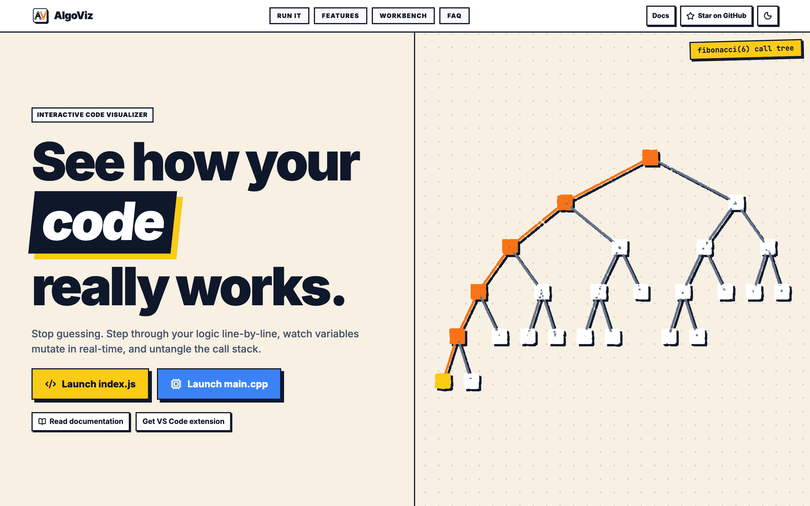

# AlgoViz

### Paste your JavaScript or C++. Watch it run, one line at a time.

Step through your own code in the browser and see every array, tree, graph, heap, stack and DP table change as it executes. No account, no install.

<p>
  <a href="https://algoviz.somyacodes.in"></a>
  <a href="https://github.com/somyacodes07/algoviz/stargazers"></a>
  <a href="https://marketplace.visualstudio.com/items?itemName=somyacodes.algoviz-vscode"></a>
</p>
<p>
  <a href="https://github.com/somyacodes07/algoviz/actions/workflows/ci.yml"></a>
  <a href="https://marketplace.visualstudio.com/items?itemName=somyacodes.algoviz-vscode"></a>
  <a href="https://marketplace.visualstudio.com/items?itemName=somyacodes.algoviz-vscode"></a>
  <a href="LICENSE"></a>
</p>

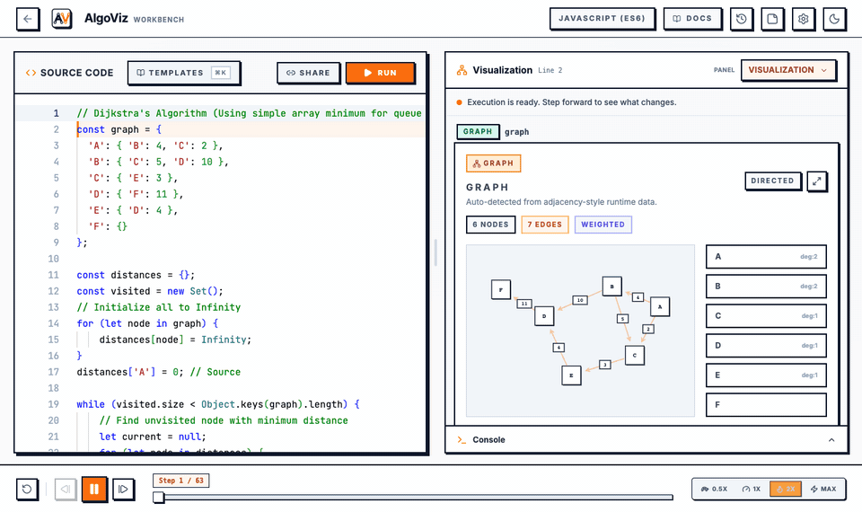

</div>

---

## Why AlgoViz

- **It runs your code, not canned animations.** Paste any algorithm and AlgoViz traces it, line by line, in a sandbox in your browser.
- **It figures out what to draw.** Arrays, strings, grids, linked lists, trees, tries, graphs, heaps, stacks, queues, hash maps and tables of structs are detected from the shape of your data.
- **It shows what each line touches.** The cells a line reads and writes are marked, so `dp[i][j] = max(dp[i-1][j], dp[i][j-1])` finally makes sense.
- **JavaScript and C++.** C++ STL containers, `priority_queue`, pairs and your own structs all show up with real field names.

## See it in action

<table>
  <tr>
    <td width="50%" valign="top">
      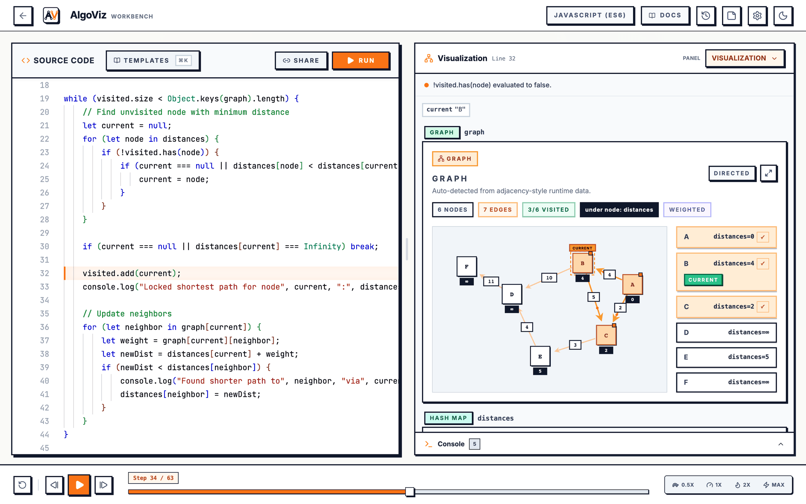
      <p align="center"><strong>Graphs with live distances</strong><br />Weights, visited nodes, the current node, and what is still waiting in the queue.</p>
    </td>
    <td width="50%" valign="top">
      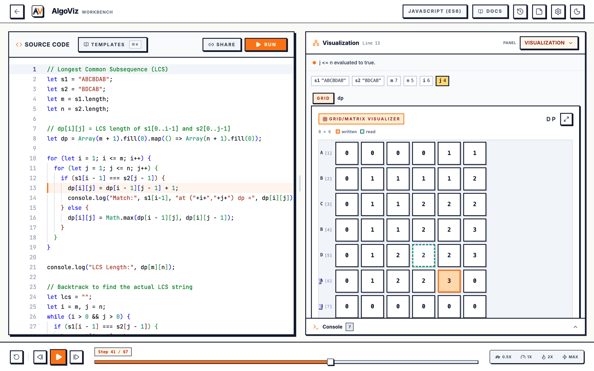
      <p align="center"><strong>DP tables that explain themselves</strong><br />Rows and columns labelled with the strings; the written cell and the cells it reads are marked.</p>
    </td>
  </tr>
  <tr>
    <td width="50%" valign="top">
      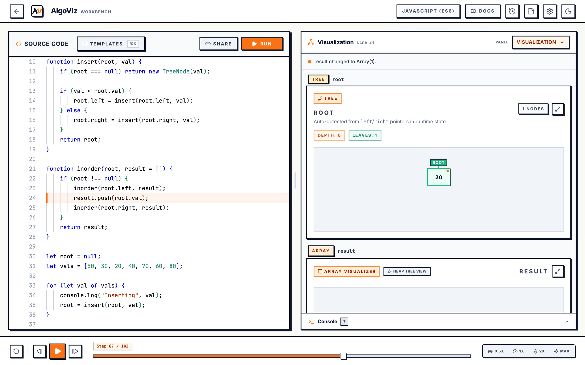
      <p align="center"><strong>Trees that survive recursion</strong><br />The whole tree stays on screen while recursive calls work on a subtree.</p>
    </td>
    <td width="50%" valign="top">
      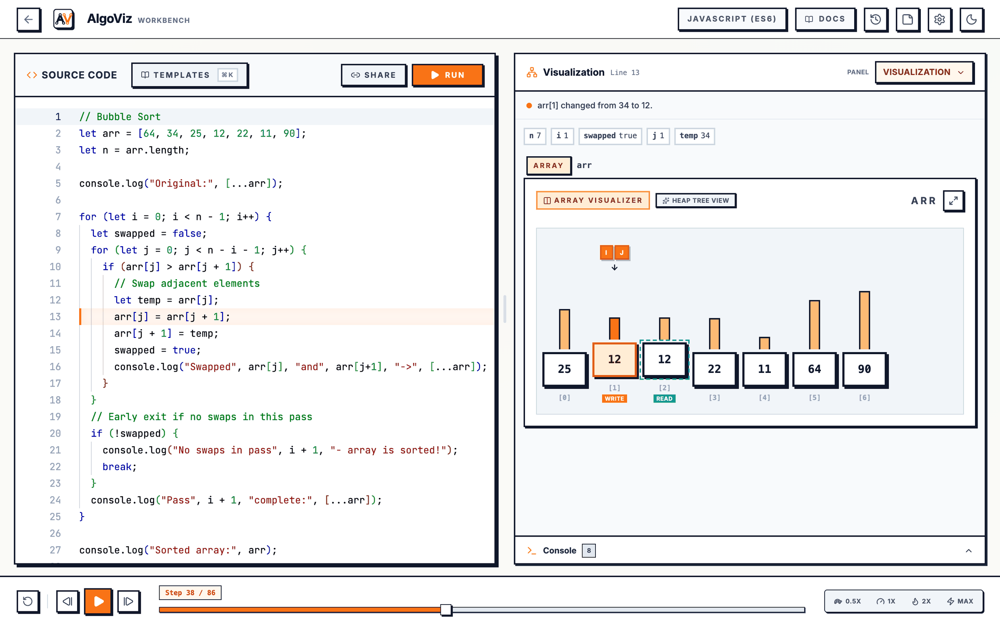
      <p align="center"><strong>Arrays, cell by cell</strong><br />Pointer tags come from the variables your code really uses as indexes.</p>
    </td>
  </tr>
  <tr>
    <td width="50%" valign="top">
      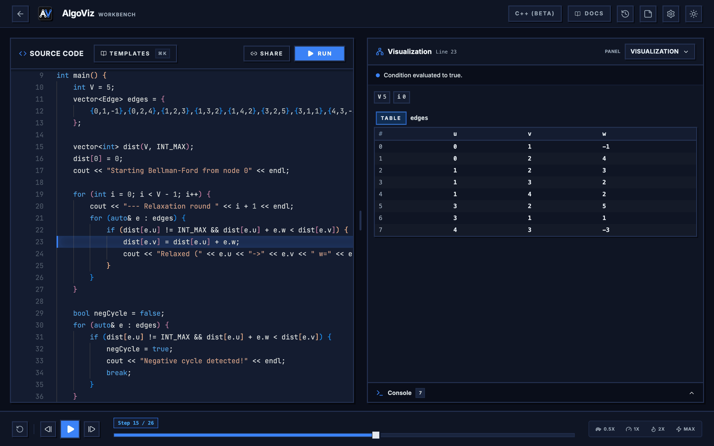
      <p align="center"><strong>C++ structs as tables</strong><br /><code>vector&lt;Edge&gt;</code> shows <code>u</code>, <code>v</code> and <code>w</code> with their real names.</p>
    </td>
    <td width="50%" valign="top">
      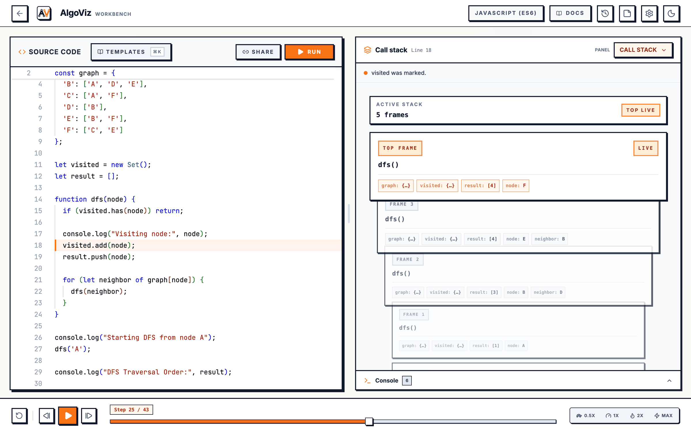
      <p align="center"><strong>The call stack, frame by frame</strong><br />Every recursive call with its own local variables.</p>
    </td>
  </tr>
</table>

<div align="center">
  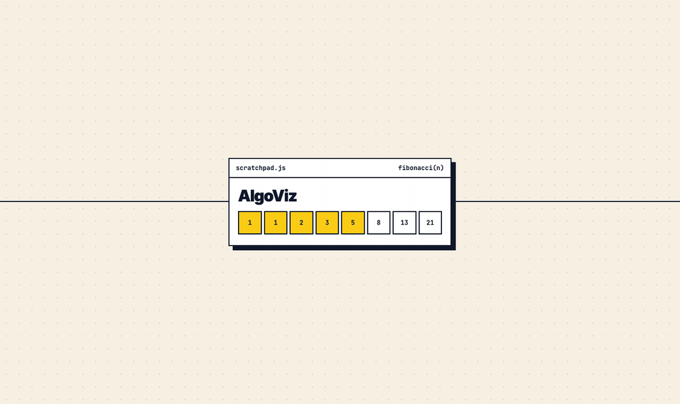
  <p><em>The landing page runs <code>fibonacci(6)</code> live. Tap any node to jump to that call.</em></p>
</div>

## Works on your phone

<div align="center">
  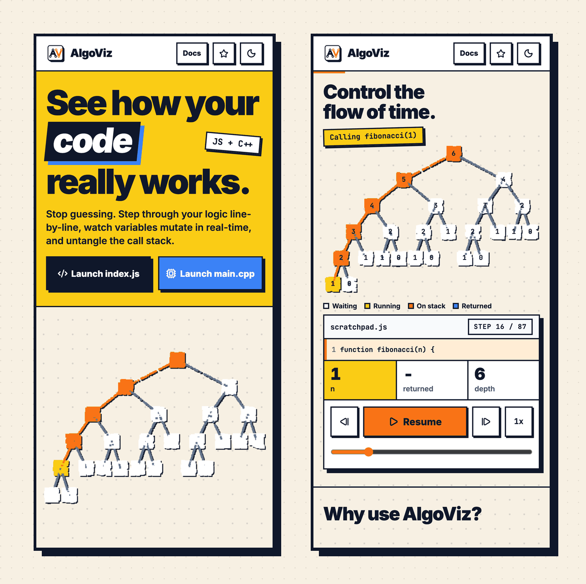
</div>

## Features

| | |
|---|---|
| **Timeline** | Play, pause, step forward and back, scrub, and change speed. Set breakpoints by clicking the gutter. |
| **Data structures** | Array, string, grid, linked list, tree, trie, graph, heap, stack, queue, priority queue, hash map, table. |
| **Read / write marks** | The cells the current line reads (dashed) and writes (filled) are highlighted. |
| **Call stack** | Each frame with its own variables, so recursion is readable. |
| **Complexity** | Big-O estimates with a heatmap of the hottest lines. Estimates are guidance, not proofs. |
| **Templates** | Press `Cmd/Ctrl + K` for 80+ ready-made algorithms in JavaScript and C++: sorting, DP, graphs, trees and more. |
| **Share and embed** | Share a link that carries your code, or embed the workbench with `?embed=true`. |
| **Annotations** | Pin notes to specific steps to build a walkthrough. |
| **VS Code** | A sidebar that highlights the running line in your own editor, asks for `cin` input, and works offline. |

## Try it

**In the browser:** open [algoviz.somyacodes.in](https://algoviz.somyacodes.in), pick `index.js` or `main.cpp`, and press **Run**.

**In VS Code:** install [AlgoViz](https://marketplace.visualstudio.com/items?itemName=somyacodes.algoviz-vscode), open a `.cpp` or `.js` file, and press **⌘⌥V** (Ctrl+Alt+V on Windows/Linux). The running line lights up in your editor, and the AlgoViz sidebar draws your data structures.

<div align="center">
  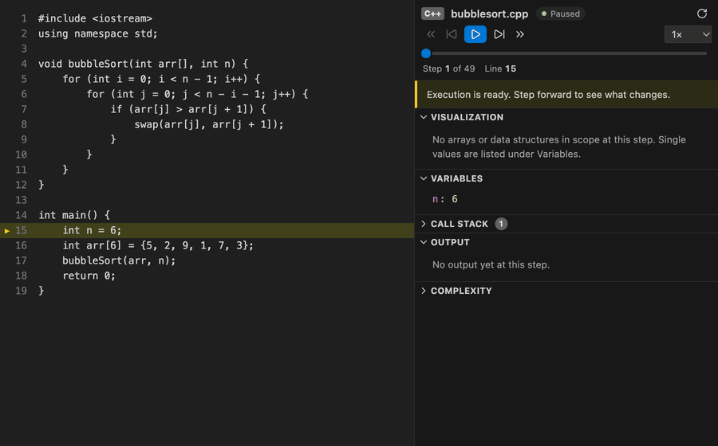
</div>

**Locally:**

```bash
git clone https://github.com/somyacodes07/algoviz.git
cd algoviz
npm install
npm run dev
```

Then open `http://localhost:3000`.

## How it works

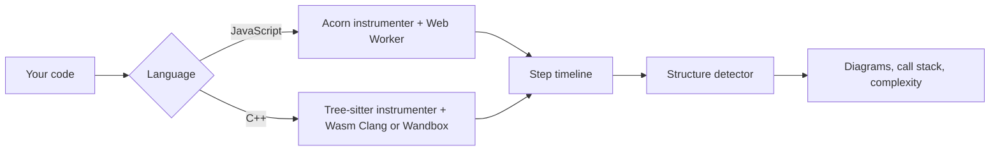

Your code is instrumented to record every variable at every step, run in a sandbox, and replayed as a timeline. A detector then decides, for each variable, which single diagram fits its shape.

- **Frontend:** React 19, Vite, Monaco Editor, Tailwind CSS, Framer Motion, GSAP and WebGL on the landing page.
- **JavaScript:** Acorn instrumentation, run in a Web Worker with a step limit.
- **C++:** Tree-sitter instrumentation, compiled with WebAssembly Clang on your machine, or remotely with GCC.

## Documentation

- [Introduction](docs/introduction.md)
- [Setup guide](docs/setup-guide.md)
- [Features and UI](docs/features-and-ui.md)
- [C++ engine](docs/cpp-engine.md)
- [Instrumentation sandbox](docs/instrumentation-sandbox.md)
- [Complexity analysis](docs/complexity-analysis.md)
- [Templates and palette](docs/templates-and-palette.md)
- [Architecture](docs/architecture.md)
- [VS Code extension](docs/vscode-extension.md)

## Contributing

Bug reports, ideas and pull requests are welcome. If a data structure shows up wrong, please [open an issue](https://github.com/somyacodes07/algoviz/issues/new/choose) with the code you ran; those reports are the fastest way to make detection better.

Read the [contributing guide](CONTRIBUTING.md) for setup, the project layout and the checks to run. Everyone taking part follows the [code of conduct](CODE_OF_CONDUCT.md). To report a security problem, see [SECURITY.md](SECURITY.md).

What changed and when: [CHANGELOG.md](CHANGELOG.md).

## Support

AlgoViz is free and open source. If it helped you learn, teach or pass an interview, a ⭐ on this repo helps more people find it, and you can [sponsor the project](https://github.com/sponsors/somyacodes07).

## License

[MIT](LICENSE) © Somyajeet Singh. Teaching with AlgoViz? See [CITATION.cff](CITATION.cff) for how to cite it.

<div align="center">
  <br />
  Made by <a href="https://github.com/somyacodes07"><strong>Somyajeet Singh</strong></a>
</div>
