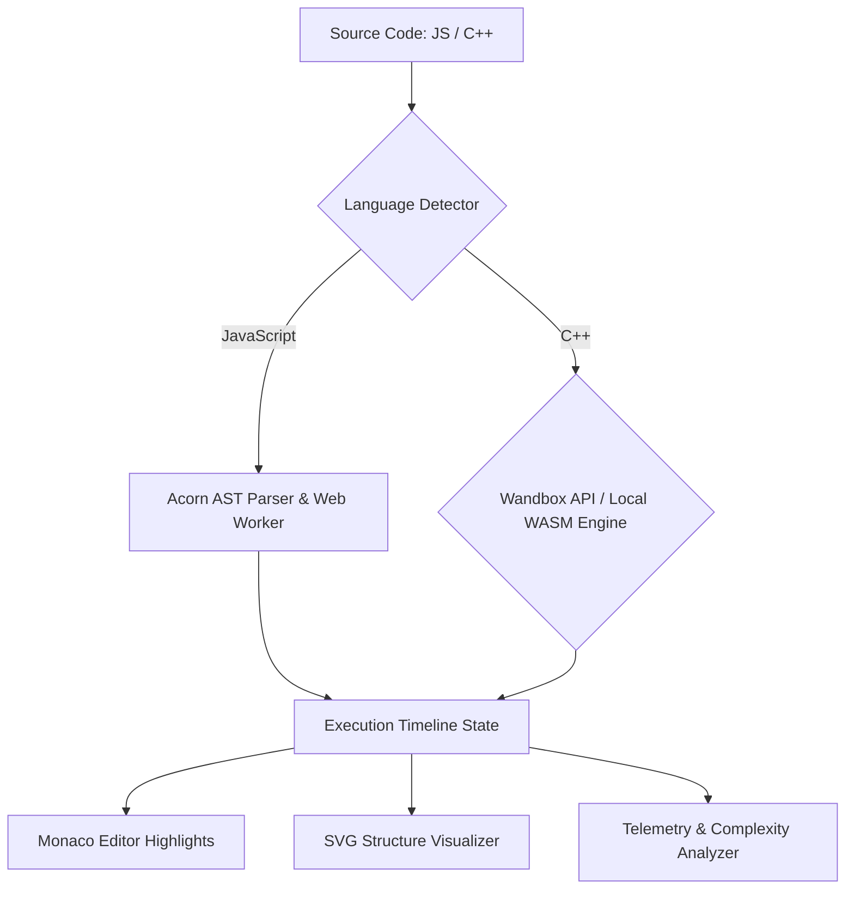

<div align="center">
  

  # ⚡ AlgoViz

  ### **Transforming Static Code into Living, Interactive Visual State**

  <p align="center">
    <a href="https://github.com/somyacodes07/algoviz-copy/stargazers"></a>
    <a href="https://github.com/sponsors/somyacodes07"></a>
    <a href="https://marketplace.visualstudio.com/items?itemName=somyacodes.algoviz-vscode"></a>
    <br/>
    <a href="."></a>
    <a href="."></a>
    <a href="."></a>
    <a href="."></a>
  </p>

  **AlgoViz** is a state-of-the-art interactive code execution and algorithm visualization platform designed for students, interview candidates, and educators. Step line-by-line through **JavaScript & C++**, inspect dynamic heap memory, track recursive call stack frames, and visualize complex data structures in real time.
</div>

---

## 🌟 Why AlgoViz?

Most code visualizers show static outputs or basic arrays. **AlgoViz** automatically detects and renders high-level data structures right as your code executes:

- 🧠 **Zero Configuration Auto-Detection**: Write standard JavaScript or C++ code (`Tree`, `Graph`, `LinkedList`, `Vector`, `Map`, `Heap`). AlgoViz inspects runtime memory and renders interactive SVG diagrams automatically.
- ⚡ **Dual C++ Execution Engine**: Execute real C++ code via public GCC Wandbox backend or fall back to an offline WebAssembly WASM engine.
- 📊 **Telemetry & Complexity Analysis**: Live Big-O Time Growth ($O(1), O(\log n), O(n), O(n \log n), O(n^2), O(2^n)$), Auxiliary Space estimate ($O(1), O(n)$), and execution hotspot heatmaps.
- 📝 **Interactive Annotations**: Add per-step sticky notes and comments directly to the execution timeline to build shareable explanations.
- 🔍 **Pan & Zoom Modal**: Expand trees, graphs, and matrices into a full-screen interactive view with drag-and-pan controls.
- 🎨 **Sleek Neo-Brutalist & Glassmorphic UI**: High-contrast, zero-lag theme transitions (Dark Mode & Saffron/Blue themes).

---

## 💖 Support the Project

AlgoViz is **100% free and open-source**. If AlgoViz helped you ace your coding interviews, understand data structures, or teach computer science, consider supporting the project on GitHub:

👉 **[Sponsor Somyajeet on GitHub](https://github.com/sponsors/somyacodes07)**

---

## 🚀 Key Features Overview

| Feature | Description |
|---|---|
| 🎬 **Scrubbable Timeline** | Inline player control bar with drag scrubber, step counters, and speed toggles (`0.5x`, `1x`, `2x`, `⚡`). |
| 🌳 **Data Structure Suite** | Auto-detected visualizers for **Trees**, **Graphs**, **Linked Lists**, **Binary Heaps**, **Hash Maps**, **Stacks/Queues**, and **2D Matrices**. |
| 🥞 **Visual Call Stack** | Deep recursion frame inspector tracking parameter mutations, stack depth, and return values. |
| 📊 **Time & Space Telemetry** | Automated Big-O detection, memory usage estimates, and line-by-line execution heatmaps. |
| ⌨️ **Command Palette** | Press `Cmd+K` / `Ctrl+K` to search over 50+ pre-built DSA templates across Sorting, DP, Graphs, Trees, and Recursion. |
| 💻 **VS Code Extension** | Run the visualizer directly inside Visual Studio Code split pane, fully offline. |

---

## 💻 VS Code Extension

Take the visualizer experience directly into your IDE:

1. Search for **AlgoViz** in the VS Code Marketplace.
2. Open any `.js` or `.cpp` file.
3. Click **AlgoViz: Visualize** from the editor run menu to view your code's step-by-step execution timeline right next to your source editor!

👉 **[Download on VS Code Marketplace](https://marketplace.visualstudio.com/items?itemName=somyacodes.algoviz-vscode)**

---

## 🖼️ Interface Gallery

<table align="center">
  <tr>
    <td width="50%" valign="top">
      
      <p align="center"><strong>Array & Pointer Tracking</strong><br />Visual pointer stalks tracking multi-window swaps.</p>
    </td>
    <td width="50%" valign="top">
      
      <p align="center"><strong>C++ STL Execution</strong><br />Real GCC compiler support for vector, map, stack, & queue.</p>
    </td>
  </tr>
  <tr>
    <td width="50%" valign="top">
      
      <p align="center"><strong>Recursive Call Stack</strong><br />Trace deep DFS call stack frames and local variables.</p>
    </td>
    <td width="50%" valign="top">
      
      <p align="center"><strong>Graph & Tree Diagrams</strong><br />Interactive SVG rendering for directed graphs and binary trees.</p>
    </td>
  </tr>
</table>

---

## 🏗️ Technical Architecture

AlgoViz runs entirely in the browser without requiring heavy setup:



- **Frontend**: React 19, Vite, Monaco Editor, TailwindCSS, Framer Motion, Lucide Icons.
- **Parsing & Instrumentation**: Acorn (JS) and Tree-sitter WASM (C++).
- **Execution Sandbox**: Web Worker isolation for safety against infinite loops.

---

## 🧭 Interactive Documentation

Want to understand how the instrumentation, compiler engine, or complex structure detection works? Check out the interactive docs site or read the markdown files directly:

- [📖 Introduction & Core Mental Model](docs/introduction.md)
- [🛠️ Setup & Installation Guide](docs/setup-guide.md)
- [✨ Features & UI Layout Workbench](docs/features-and-ui.md)
- [⚙️ C++ Dual Execution Engine](docs/cpp-engine.md)
- [🛡️ Instrumentation Sandbox](docs/instrumentation-sandbox.md)
- [📊 Complexity & Telemetry Analysis](docs/complexity-analysis.md)
- [🎨 Template Library & Command Palette](docs/templates-and-palette.md)
- [📐 Architecture Reference](docs/architecture.md)
- [💻 VS Code Extension Guide](docs/vscode-extension.md)

---

## ⚡ Local Setup

```bash
# 1. Clone the repository
git clone https://github.com/somyacodes07/algoviz.git
cd algoviz

# 2. Install dependencies
npm install

# 3. Start local development server
npm run dev
```

Open `http://localhost:3000` in your web browser.

---

## 🤝 Contributing

Contributions, bug reports, and feature requests are very welcome! Feel free to check out the [issues page](https://github.com/somyacodes07/algoviz/issues).

1. Fork the Project
2. Create your Feature Branch (`git checkout -b feature/AmazingFeature`)
3. Commit your Changes (`git commit -m 'Add some AmazingFeature'`)
4. Push to the Branch (`git push origin feature/AmazingFeature`)
5. Open a Pull Request

---

## 📜 License

Distributed under the MIT License. See `LICENSE` for more information.

<div align="center">
  <br />
  Made with ❤️ by <strong><a href="https://github.com/somyacodes07">Somyajeet Singh</a></strong>
  <br /><br />
  <a href="https://github.com/sponsors/somyacodes07"></a>
</div>
