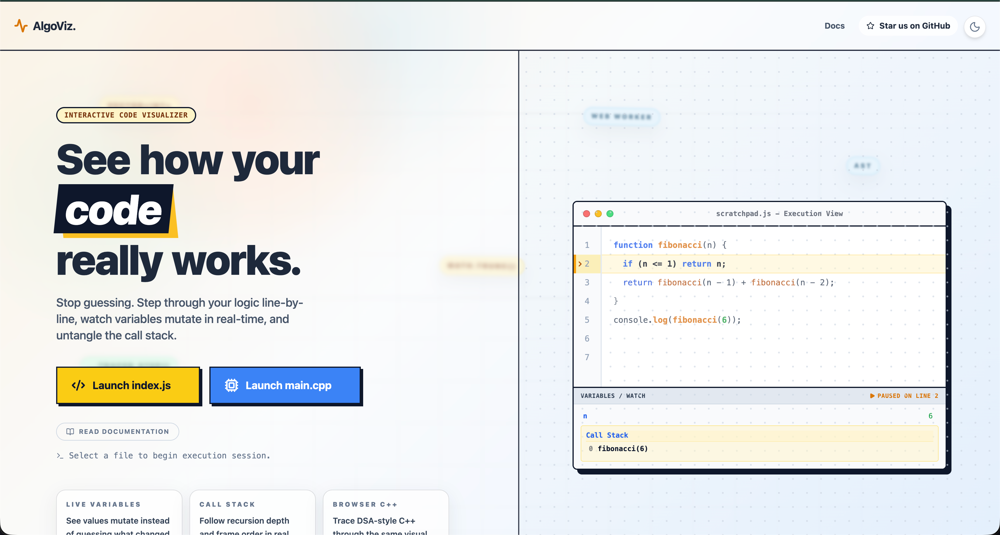
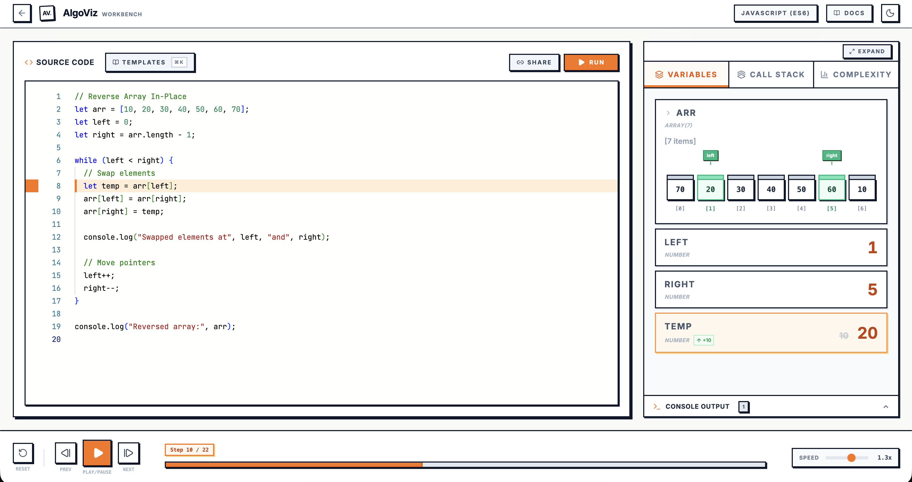
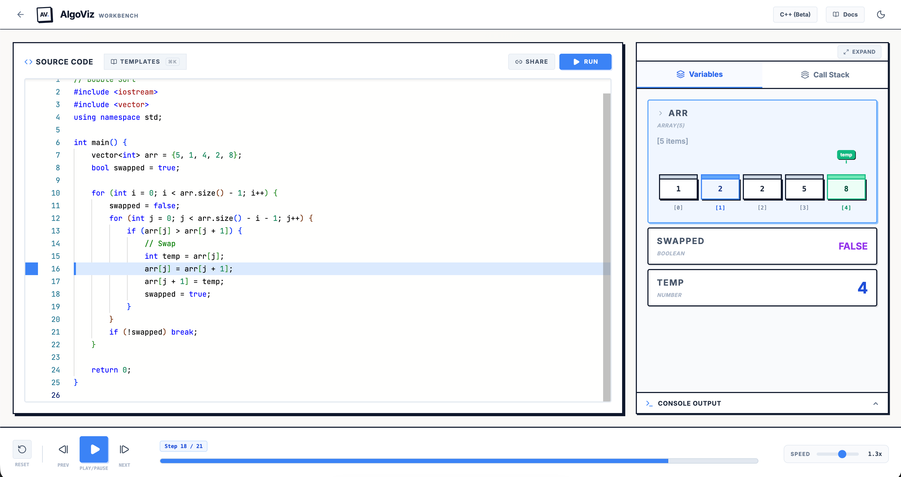
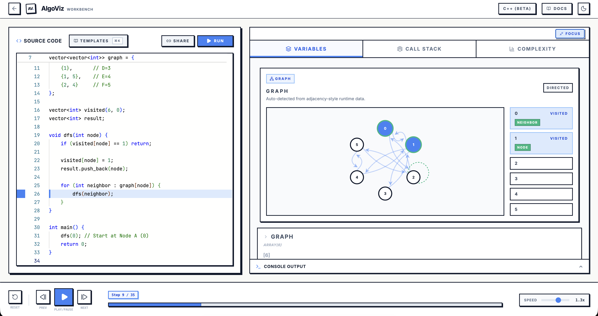

<div align="center">

# ⚡ AlgoViz

### Interactive algorithm visualizer for JavaScript and C++

**Step through code line-by-line, inspect variables in real time, analyze complexity, and replay execution inside a browser workbench.**

[](https://github.com/ssgamingop)
[](.)
[](.)
[](.)

</div>

---

## 🎯 What Is AlgoViz?

AlgoViz is a browser-based code visualizer built for students, educators, and anyone who wants to understand runtime behavior instead of only final output.

Write **JavaScript** or **C++**, hit Run, and scrub through execution like a video timeline:

- See the active line move through the editor
- Watch variables mutate step-by-step
- Track recursion and nested calls in the call stack
- Replay console output exactly when it appears
- Analyze time complexity with live hotspot heatmaps
- Teach search, sorting, graph, and pointer-heavy problems visually

---

## 💻 VS Code Extension

AlgoViz is now available directly inside your IDE! You can visualize your code without ever leaving your editor.

- **Offline Execution**: Runs locally using the built-in Web Worker and transpiler (Zero API calls).
- **Run Menu Integration**: Just click **AlgoViz: Visualize** from the editor's Play/Run dropdown menu.
- **Side-by-Side View**: Opens the visualizer in a split pane, pulling in your active code automatically.

Check out the `algoviz-extension/` folder or the [VS Code Extension Docs](docs/vscode-extension.md) for more info!

---

## 🧭 Documentation

- [Introduction & Philosophy](docs/introduction.md)
- [Setup & Installation Guide](docs/setup-guide.md)
- [Features & UI Layouts](docs/features-and-ui.md)
- [C++ Execution Engine](docs/cpp-engine.md)
- [Instrumentation Sandbox](docs/instrumentation-sandbox.md)
- [Complexity Analysis](docs/complexity-analysis.md)
- [Template Library & Palette](docs/templates-and-palette.md)
- [Architecture Reference](docs/architecture.md)

---

## 🖼️ Product Tour

### Landing Experience

<div align="center">
  
</div>

### Workbench Gallery

<table>
  <tr>
    <td width="50%" valign="top">
      
      <p>
        <strong>JavaScript state tracing</strong><br />
        Reverse-array execution with live pointer markers and variable updates.
      </p>
    </td>
    <td width="50%" valign="top">
      
      <p>
        <strong>C++ execution (GCC powered)</strong><br />
        Bubble sort compiled by real GCC, with full STL support and step-by-step tracing.
      </p>
    </td>
  </tr>
  <tr>
    <td width="50%" valign="top">
      
      <p>
        <strong>Recursive call stack replay</strong><br />
        Stack frames stay readable while DFS expands through nested calls.
      </p>
    </td>
    <td width="50%" valign="top">
      
      <p>
        <strong>Data structure snapshots</strong><br />
        Graph traversal state shown as evolving arrays and tracked values.
      </p>
    </td>
  </tr>
</table>

---

## ✨ Core Features

| Feature | Description |
|---|---|
| 🔬 **Step-by-step execution** | Play, pause, scrub, and move line-by-line through the program timeline |
| 📊 **Live variables panel** | Inspect scalars, arrays, vectors, maps, and tracked values as state changes |
| 🎯 **Pointer visualization** | Follow indices like `i`, `j`, `left`, `right`, and `mid` visually |
| 📚 **Call stack view** | Watch frames push and pop during recursion and nested calls |
| 💻 **Console replay** | See `console.log` and `cout` output appear at the exact step it is emitted |
| 📈 **Complexity analysis** | Live O(n) estimation with hotspot heatmap, peak stack depth, and hot-line detection |
| 🧠 **Template palette** | Load tagged DSA examples quickly through the searchable template library |
| 🟧 **JavaScript mode** | Full support for loops, recursion, arrays, objects, and interview-style problems |
| 🔵 **C++ mode (GCC)** | Real GCC compilation via Wandbox API with automatic local transpiler fallback |
| 📖 **Integrated docs route** | Architecture, setup, UI, templates, and engine details accessible from the app |

---

## 🏗️ How C++ Execution Works

AlgoViz uses a **dual-engine architecture** for C++:

```
┌─────────────────────────────────────────────────────────┐
│                   User clicks "Run"                     │
└───────────────────────┬─────────────────────────────────┘
                        │
                        ▼
              ┌─────────────────┐
              │  C++ Detected   │
              └────────┬────────┘
                       │
            ┌──────────▼──────────┐
            │  PRIMARY ENGINE     │
            │  Wandbox API (GCC)  │
            │  Source-to-source   │
            │  instrumentation    │
            └──────────┬──────────┘
                       │
              ┌────────▼────────┐
              │  API Available? │
              └───┬─────────┬───┘
                Yes         No
                 │           │
                 ▼           ▼
        ┌────────────┐  ┌────────────────┐
        │ Real GCC   │  │ FALLBACK       │
        │ compiles + │  │ Local C++→JS   │
        │ runs code  │  │ transpiler in  │
        │ with trace │  │ Web Worker     │
        └─────┬──────┘  └───────┬────────┘
              │                 │
              └────────┬────────┘
                       ▼
              ┌─────────────────┐
              │  Timeline data  │
              │  + Complexity   │
              │  analysis       │
              └────────┬────────┘
                       ▼
              ┌─────────────────┐
              │  Visual replay  │
              │  in React UI    │
              └─────────────────┘
```

### Primary: Wandbox API
- Sends instrumented C++ to [Wandbox](https://wandbox.org) for real **GCC compilation**
- Full support for STL containers, OOP, templates, and any standard C++
- `__trace()` calls injected via Tree-sitter AST produce JSON state output

### Fallback: Local Transpiler
- If Wandbox is unreachable (no internet, API down), seamlessly falls back
- Tree-sitter parses C++ → transformer maps to JavaScript → runs in Web Worker
- Covers the DSA-focused subset: vectors, maps, loops, recursion

---

## 🧱 Project Structure

```text
algoviz/
├── App.tsx                          # Main application component
├── types.ts                         # Shared TypeScript interfaces
├── README.md
│
├── backend/
│   ├── analysis/
│   │   └── complexity.ts            # Time complexity analyzer (AST + timeline heuristic)
│   ├── tracer/
│   │   └── instrumenter.ts          # JS AST instrumentation (Acorn-based)
│   └── sandbox/
│       ├── runtime/
│       │   ├── executor.ts          # Execution router (Wandbox → Worker fallback)
│       │   ├── executor.worker.ts   # Sandboxed Web Worker for JS/fallback C++
│       │   └── wandboxExecutor.ts   # Wandbox API client + trace parser
│       ├── transpiler/
│       │   ├── parser.ts            # Tree-sitter WASM C++ parser
│       │   ├── cppInstrumenter.ts   # C++ source-to-source trace injector
│       │   ├── transformer.ts       # C++ → JS AST transformer
│       │   ├── generator.ts         # JS code emitter
│       │   └── index.ts             # Transpiler public API
│       └── legacy/
│           └── regexTranspiler.ts   # Regex-based fallback transpiler
│
├── frontend/
│   ├── components/
│   │   ├── layout/                  # WorkspaceHeader, Editor, Visualizer shells
│   │   ├── visualizer/              # GraphVisualizer, LinkedListVisualizer
│   │   ├── HomePage.tsx             # Landing page
│   │   ├── DocsPage.tsx             # Documentation viewer
│   │   ├── CodeEditor.tsx           # Monaco-based code editor
│   │   ├── VariablesPanel.tsx       # Live variable state display
│   │   ├── CallStackPanel.tsx       # Call stack frame viewer
│   │   ├── ConsolePanel.tsx         # Console output replay
│   │   ├── PerformancePanel.tsx     # Complexity analysis dashboard
│   │   ├── Controls.tsx             # Playback controls
│   │   └── TemplatePalette.tsx      # Cmd+K template picker
│   ├── hooks/
│   │   └── useExecutionEngine.ts    # Execution state management hook
│   └── theme/
│       └── theme.ts                 # Design tokens
│
├── docs/                            # Markdown documentation source
├── public/                          # Static assets, WASM files, icons
└── assets/                          # README screenshots
```

---

## 🚀 Getting Started

### Prerequisites

- [Node.js](https://nodejs.org/) 18+
- Active internet connection (for C++ Wandbox engine; offline uses local fallback)

### Installation

```bash
git clone https://github.com/ssgamingop/algoviz.git
cd algoviz
npm install
npm run dev
```

The app runs locally at `http://localhost:3000`.

### Production Build

```bash
npm run build
npm run preview
```

---

## 🛠️ Tech Stack

| Technology | Purpose |
|---|---|
| **React 19** | UI and route-driven app shell |
| **TypeScript** | Type safety across frontend and backend code |
| **Vite** | Dev server and production build |
| **Monaco Editor** | VS Code-grade code editing surface |
| **Framer Motion** | UI motion and route transitions |
| **Acorn** | JavaScript AST instrumentation |
| **web-tree-sitter** | Browser C++ parsing (WASM) |
| **Wandbox API** | Remote GCC compilation for C++ |
| **React Markdown** | Rendered docs experience |
| **Lucide React** | Iconography |

---

## 📈 Complexity Analysis

AlgoViz provides **live time complexity estimation** for both JavaScript and C++:

| Signal | How It Works |
|---|---|
| **Loop depth** | Detects nested `for`/`while` loops via AST (JS) or timeline hit patterns (C++) |
| **Logarithmic loops** | Identifies `i *= 2`, `i /= 2` patterns or log₂(n)-scale hit counts |
| **Recursion** | Tracks self-calls and branching recursion (e.g. Fibonacci → `O(2^n)`) |
| **Sort detection** | Recognizes `sort()` calls → signals `O(n log n)` |
| **Hotspot heatmap** | Shows which lines execute most frequently with hit counts and shares |
| **Peak stack depth** | Measures maximum call stack depth during execution |

For C++, complexity is inferred from runtime trace data using a timeline-based heuristic when the Acorn JS parser can't process the source.

---

## 📝 Typical Workflow

1. Open the landing page and choose **JavaScript** or **C++**.
2. Write code or load a template from the palette (`Cmd+K`).
3. Click **Run**.
4. Step through the timeline with playback controls.
5. Inspect variables, pointers, console output, and the call stack as the program evolves.
6. Check the **Complexity** tab for time complexity estimate and hot-line heatmap.
7. Open the docs route when you want the architecture behind the visualizer.

---

## 🤝 Contributing

Contributions are welcome.

- Report bugs through [Issues](https://github.com/ssgamingop/algoviz/issues)
- Suggest features or docs improvements
- Open a pull request with focused changes

---

## 📄 License

This project is open source and available under the [MIT License](LICENSE).

---

<div align="center">

**Built by [Somyajeet Singh](https://github.com/ssgamingop) with ❤️**

*AlgoViz makes runtime behavior visible.*

</div>
