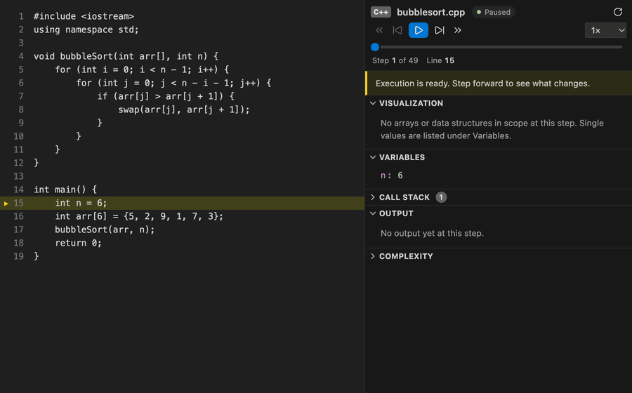
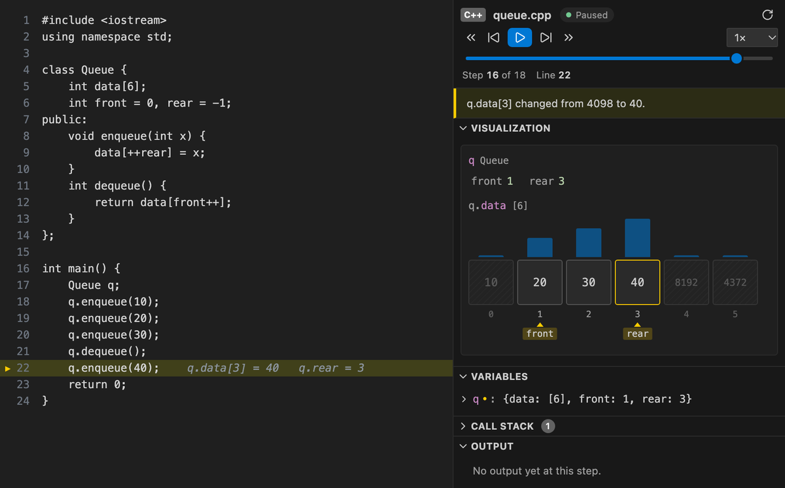
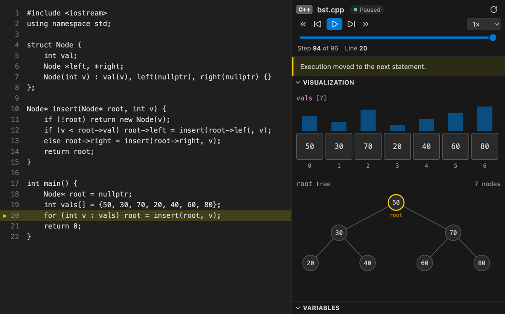

# AlgoViz — see your code run

Step through your C++ or JavaScript one line at a time, right in VS Code. The line that runs lights up in your editor, and a side panel draws your arrays, queues, stacks, linked lists, trees and graphs as they change.

It's made for students learning data structures, and for teachers showing an algorithm to a class. There's nothing to set up: no compiler to install, no debugger config, and it works offline.

## Start in 10 seconds

1. Open a `.cpp`, `.c`, `.js` or `.ts` file.
2. Press **⌘⌥V** on macOS or **Ctrl+Alt+V** on Windows/Linux. You can also click the AlgoViz icon in the Activity Bar.
3. Press **▶** to play, or step with **⌘⌥→ / ⌘⌥←** (Ctrl+Alt on Windows/Linux).

If your program reads input with `cin` or `prompt()`, AlgoViz asks for it first. Type the values, press **Run**, and it remembers them for that file.

## What you see

| | |
| --- | --- |
|  | **Arrays and classes.** Each cell shows its index. Variables like `i`, `j`, `front` and `rear` appear as markers under the cells they point at. Slots a queue or stack isn't using are greyed out. |
|  | **Trees, lists and graphs.** Nodes are drawn the way a textbook draws them. Pointers such as `head`, `prev` and `curr` are tagged on the nodes they point to. In BFS, visited nodes are filled in and queued ones are dashed. |

The panel also explains each step in plain words, for example "arr[3] changed from 9 to 1". It also shows:

- **Variables** and the **Call Stack**, laid out like the Run and Debug view.
- **Output** up to the current step.
- A rough **time complexity** estimate, with the lines that run most often.

In the editor itself, the changed values appear at the end of the highlighted line (`swap arr[2] ⇄ arr[3]`). Compile errors are underlined on the right line.

## Keys

| Action | macOS | Windows / Linux |
| --- | --- | --- |
| Visualize the current file | ⌘⌥V | Ctrl+Alt+V |
| Step forward / back | ⌘⌥→ / ⌘⌥← | Ctrl+Alt+→ / Ctrl+Alt+← |
| Play / pause | ⌘⌥P | Ctrl+Alt+P |
| Run to the line with the cursor | ⌘⌥↵ | Ctrl+Alt+Enter |
| Stop | ⇧Esc | Shift+Esc |

Breakpoints you set in the gutter pause playback. Saving the file runs it again and keeps you on the same step.

## For teachers

Drag the AlgoViz view into the **secondary side bar** or the bottom panel and make it wide. The drawings scale to the space, and the code stays on screen beside them. Use **Run to Cursor** to jump straight to the interesting part of the algorithm.

## How your code runs

- **C++** is compiled on your computer by a WebAssembly build of Clang that ships with the extension. Nothing is sent anywhere, and it works offline. The first run takes a couple of seconds while the compiler loads; later runs are almost instant. If you prefer GCC, set `algoviz.cppCompiler` to `api`, which sends your code to Compiler Explorer.
- **JavaScript and TypeScript** (traced as JavaScript) run in a sandboxed worker inside the view.

AlgoViz traces small, teaching-sized programs. Very long loops stop after a few thousand steps.

## Settings

| Setting | Default | What it does |
| --- | --- | --- |
| `algoviz.cppCompiler` | `wasm` | `wasm` compiles locally (offline). `api` uses remote GCC. |
| `algoviz.rerunOnSave` | `true` | Trace the file again when you save it. |
| `algoviz.inlineValues` | `true` | Show changed values at the end of the highlighted line. |
| `algoviz.followExecution` | `true` | Scroll the editor to keep the running line visible. |
| `algoviz.playbackSpeed` | `600` | Milliseconds per step while playing. |

## Feedback

Found a program it draws wrong? [Open an issue](https://github.com/somyacodes07/algoviz/issues) and paste the code. AlgoViz is open source: [github.com/somyacodes07/algoviz](https://github.com/somyacodes07/algoviz).
