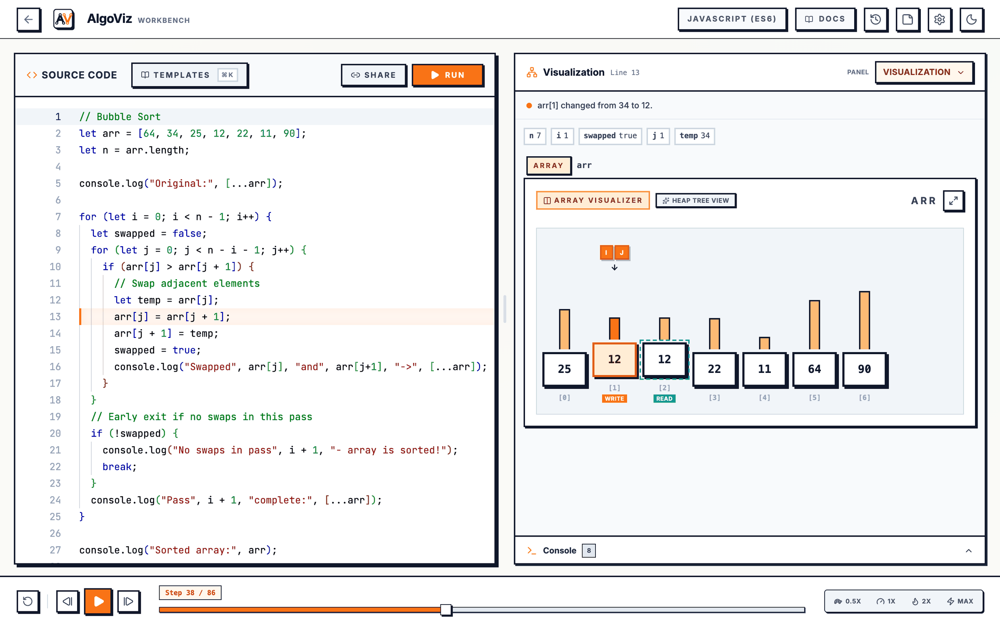
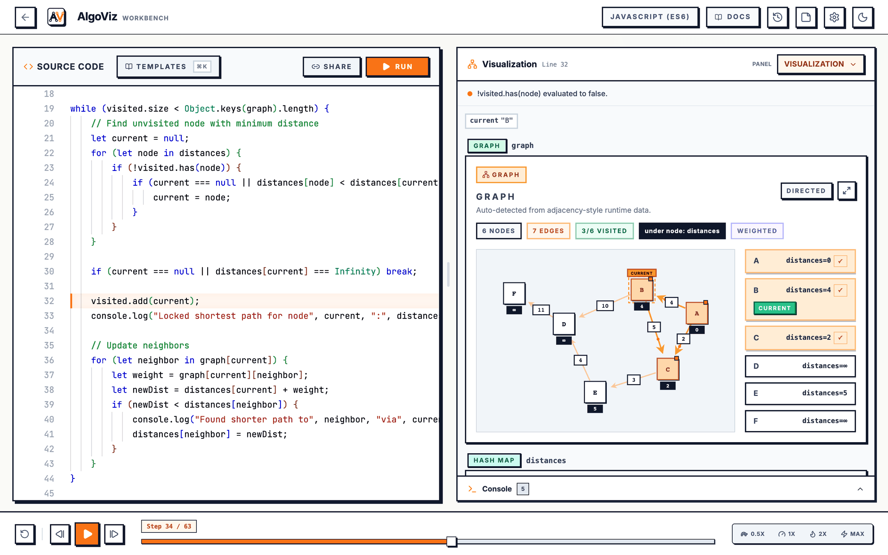
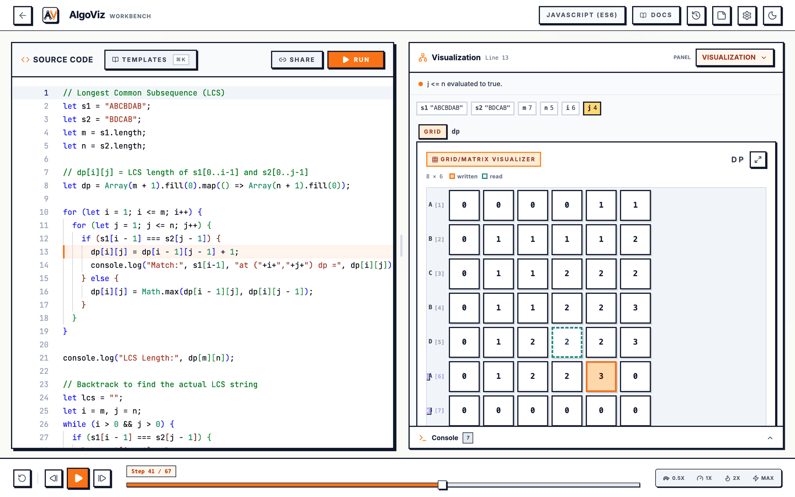

# Features & UI Layouts

AlgoViz uses a **Neo-Brutalist Developer's Workbench** design with bold typography, high contrast borders, and precise geometric layouts. The UI leverages the **Native View Transitions API** for seamless, hardware-accelerated dark/light mode toggling, creating a stunning visual experience without sacrificing performance.

## 1. Step-by-Step Execution

The timeline playback system lets you:

- **Play/Pause** through execution automatically
- **Step forward/backward** one statement at a time
- **Scrub** the timeline slider to jump to any point
- **Adjust speed** from slow (detailed study) to fast (overview)
- **Reset** to re-run with the same code

## 2. Execution Details

The workspace panel selector lets users switch between a detected diagram, Variables, Call stack, and Complexity. When there is no diagram to show, the workspace defaults to Variables. The current step summary calls out observable changes such as an array swap, pointer move, or scalar update.

On phones, **Code** and **Workspace** are full-size switchable views so the editor and visualization do not have to compete for narrow screen space. On desktop, both remain side by side and can be resized.

The Variables view shows in-scope values:

- Scalars display with their current value
- Arrays and vectors render as indexed blocks
- Objects and maps display as key-value pairs
- Changed values are highlighted on each step

## 3. Array Pointers and Cell Access

A pointer tag sits above an array cell when a variable indexes it. AlgoViz reads the source to find the variables used inside `arr[...]`, and also keeps conventional names (`i`, `j`, `k`, `left`, `right`, `lo`, `hi`, `low`, `high`, `mid`, `slow`, `fast`). Constants that happen to be small numbers, like `target` or `maxVal`, are not drawn as pointers.

The current line is read too. Cells it **writes** are filled orange, and cells it **reads** get a dashed blue outline. In `dp[i][j] = Math.max(dp[i - 1][j], dp[i][j - 1])` you see the one cell being written and the two it depends on. This works for arrays, strings, grids and tables, and for index expressions such as `Math.floor((i - 1) / 2)` or `dp[i - 1][w - weights[i - 1]]`.

## 4. Complexity Estimates

The Complexity view provides heuristic estimates, not a proof of asymptotic complexity:

- **Big-O notation** estimated from source structure (JS) or runtime trace patterns (C++)
- **Operations count** showing total traced steps
- **Unique lines** executed
- **Peak stack depth** for recursion analysis
- **Hot-line heatmap** showing which lines run most frequently
- Available for **JavaScript and C++**; treat estimates as guidance, especially for code that does not match common algorithm patterns.

## 5. Command Palette Templates

Press `Cmd+K` to launch the **Templates Command Palette**:

- **Search & Sort**: Quick Sort, Bubble Sort, Merge Sort, Binary Search
- **Data Structures**: Linked List traversals, Stack implementations
- **Graphs**: BFS, DFS, Dijkstra
- **Math**: Sieve of Eratosthenes, Fibonacci
- Available for both JavaScript and C++

## 6. Monaco Code Editor

Microsoft's Monaco Editor provides:

- Full syntax highlighting for JavaScript and C++
- The active line highlights as the execution cursor steps through time
- Dark mode support

## 7. Call Stack View

The Call Stack tab dynamically visualizes function call depth:

- Watch recursive trees branch and collapse
- See Fibonacci DFS or dynamic programming branches expand
- Track which function is currently executing

## 8. Console Output

The Console panel replays `console.log` (JS) and `cout` (C++) output:

- Output appears at the exact step it was emitted
- Error messages display with distinct styling
- Long output is gracefully truncated

## 9. Data Structure Visualizers

Each variable is shown in exactly one diagram. AlgoViz decides from the value's **shape** first and only then from how the code uses it, so one array never appears as a heap, a stack and an array at once.

| Shape in memory | Diagram | Notes |
|---|---|---|
| Array of numbers or strings | **Array** (cells or bars) | Read/write marks and pointer tags. |
| String indexed by the code (`s[i]`) | **String** as characters | Two-pointer and sliding-window problems. |
| Rectangular 2D array | **Grid** | Fits the panel; DP tables over two strings are labelled with their characters; `Infinity` and `INT_MAX` show as `∞`. |
| Array pushed and popped | **Stack** | Also `std::stack`, or names like `stack`. |
| Array pushed and shifted | **Queue** | Also `std::queue`/`std::deque`; `pq` or `std::priority_queue` of pairs is a priority queue. |
| Numeric array named like a heap, or used by heap code | **Min / max heap** | Min or max is read from the values, not the name. |
| Objects with `next` | **Linked list** | Two separate lists (like `prev` and `curr` while reversing) are both drawn. |
| Objects with `left`/`right` or `children` | **Tree** | Tries with `children` maps or `Node* children[26]` are labelled by letter. |
| Adjacency map, index list or `[to, weight]` list | **Graph** | Distances or in-degrees under each node, queued nodes dashed. |
| Array of records with the same fields | **Table** | `vector<Edge>` with `{u, v, w}`, activity lists. |
| Object or `Map` of plain values | **Hash map** | Changed keys flash. |

Containers inside a class instance are found too: `new MinHeap()` shows its `heap` array, and a queue built from two stacks shows both.

A strip of the current scalar values sits above the diagrams, so pointers like `left` and `right` stay visible next to the structure.

When recursion passes a subtree under the same name (`insert(root.left, val)`), the whole tree stays on screen with a tag on the node the current call is working on. A structure that goes out of scope is kept, faded, and labelled *Out of scope, last known value*.

## 10. Share Feature

Click the **Share** button to generate a shareable URL that encodes your current code, making it easy to share algorithms with classmates or students.

## 11. Preferences & Settings Panel

Click the gear icon in the Workbench header to open the Preferences dialog:
- **Permanent Theme Accent**: Toggle between **Auto** (language-adaptive saffron/blue theme transition), **Saffron** (JavaScript-styled orange Neo-Brutalist look), or **Blue** (C++ styled blue look) to pin your preferred layout style.
- **C++ Compiler Strategy**: Choose **Wandbox Remote API** (sends instrumented code to a remote compiler) or **WebAssembly Clang Engine** (runs the compiler bundle in the browser). Wandbox is the current default; Wasm mode can fall back to Wandbox if initialization fails.
- **Default Array Rendering**: Configure 1D array visualizers to display standard **Memory Cells** or numeric **Bar Charts** (height communicates relative ordering).

## 12. Enlarged Diagram View (Zoomable & Pannable Modal)

Click the Maximize icon (`Maximize2`) on visualizers (Tree, Graph, List, Grid/Matrix) to open a high-resolution, full-screen overlay modal with a blurred background:
- **Interactive Panning**: Click and drag your mouse cursor to slide and reposition large tree node structures or matrix grids.
- **Dynamic Zooming**: Scroll your mouse wheel or use trackpad pinch-to-zoom to scale the diagrams up and down smoothly.
- **Floating HUD controls**: Use the on-screen buttons to **Zoom In**, **Zoom Out**, **Reset Pan/Zoom**, and **Close** the modal.
- **Keyboard Shortcuts**: Focus the modal and use:
  - `Escape` key to close the overlay.
  - `+` / `-` keys to zoom in and out.
  - `0` key to reset translation and scale.
  - `Arrow Keys` (`Up`, `Down`, `Left`, `Right`) to pan the viewport step-by-step.

## 13. Variables Sparkline Graphing

Traces the historical value of numeric variables over the execution timeline, drawing mini inline SVG sparkline trendlines with gradient area fills next to variable values. Helps quickly identify sorting swaps, monotonic trends, and nested loops counters.

## 14. Virtual Stack Frame Variables

Reconstructs local variables inside Call Stack frame cards by walking backward dynamically. Traces recursive parameters (e.g., recursive `low`, `high`, `mid` values in binary searches, or coordinates in DFS backtracking) across every stack frame simultaneously.

## 15. Sticky Note Annotations

A built-in markdown editor that lets you attach notes to specific execution steps.
- **Step-Aware**: Notes are tied to the execution timeline. When playback hits a step with an attached note, it smoothly pops up in the workspace.
- **Markdown Support**: Render `code snippets`, bold text, lists, and links.
- **Persistent State**: Notes are securely saved in `localStorage` and tied to the underlying source code's hash, so they are restored when you revisit the same algorithm.

## 16. Embed Mode

You can securely embed the entire visualizer experience inside an `iframe` or applications like Notion.
- Append `?embed=true` to the URL.
- This strips away the top navigation header and locks the visualizer into a clean, minimalist UI optimized for educational content integration.

